<div align="center">



# 🤖 Awesome Agentic API Integration Tooling ⚡

<a href="https://github.com/ishandutta2007/Awesome-Awesome-Awesome"></a><a href="https://discord.gg/jc4xtF58Ve"></a> <a href="https://github.com/ishandutta2007/Awesome-Agentic-API-Integration-Tooling/stargazers"></a> <a href="https://github.com/ishandutta2007/Awesome-Agentic-API-Integration-Tooling/network/members"></a> <a href="https://github.com/ishandutta2007/Awesome-Agentic-API-Integration-Tooling/issues"></a> <a href="https://github.com/ishandutta2007/Awesome-Agentic-API-Integration-Tooling/blob/main/LICENSE"></a> <a href="https://github.com/ishandutta2007"></a>

**Curated Directory of SaaS Products, MCP Gateways & Open-Source Projects for Autonomous AI Agents**  
*Focused on Tool Calling, Auth Gateways, OAuth Boundaries, and Agent Function Execution*

*Last updated: March 2026*

</div>

---

## 📖 Overview

As Large Language Models (LLMs) transition from conversational interfaces into autonomous **Agentic AI systems**, the ability to securely discover, authenticate, and execute APIs in the physical and digital world has become foundational infrastructure. 

This repository tracks the leading **SaaS platforms**, **Model Context Protocol (MCP) gateways**, and **open-source runtimes** that empower AI agents to interact with SaaS applications, databases, and microservices—bridging the gap between probabilistic LLM reasoning and deterministic software execution.

---

## 📑 Table of Contents

- [🌐 Sector Overview & Market Dynamics](#-sector-overview--market-dynamics)
- [💼 SaaS / Hosted Platforms](#-saas--hosted-platforms)
- [🔓 Open-Source GitHub Projects](#-open-source-github-projects)
- [🏗️ Recommended Architecture & Tool Chaining](#️-recommended-architecture--tool-chaining)
- [🤝 How to Contribute](#-how-to-contribute)
- [⚠️ Disclaimer & Security Best Practices](#️-disclaimer--security-best-practices)
- [⭐ Star History](#-star-history)
- [💖 Support](#-support)

---

## 🌐 Sector Overview & Market Dynamics

The **Agentic AI and Tool Integration** market is estimated at **$5.1 billion in 2024–2025** and is projected to surpass **$38.5 billion by 2030**, growing at a **Compound Annual Growth Rate (CAGR) of 41.2%**, propelled by enterprise demand for autonomous workflows and standardized tool protocols.

Currently, the sector exhibits **moderate-to-high fragmentation** across specialized functional layers:
- **Auth & Credential Gateways** (e.g., Composio, OpenConnector, Arcade MCP)
- **Protocol Standardization & Tool Registries** (e.g., Anthropic MCP, Smithery)
- **Workflow & Background Execution Runtimes** (e.g., n8n, Dify, Activepieces, Trigger.dev, Windmill)
- **Unified SaaS Abstraction APIs** (e.g., Zapier, Apideck)

Because switching costs remain relatively low and open protocols like the **Model Context Protocol (MCP)** are gaining universal adoption across IDEs (Claude Desktop, Cursor, Windsurf) and agent frameworks, the sector has resisted single-vendor "winner-take-all" concentration. Instead, platform consolidation is occurring horizontally around open protocol specifications, while proprietary platforms compete aggressively on managed enterprise security, compliance boundaries (SOC 2, HIPAA), and out-of-the-box connector catalogs.

---

## 💼 SaaS / Hosted Platforms

Below is the curated benchmark of hosted platforms enabling agent function execution and tool calling. The table is sorted in **descending order by company scale** (estimated valuation / capital raised / ARR).

| 🏢 Platform | 📊 Company Scale (Valuation / Revenue) | 🎯 Core Agentic Capabilities & Focus | 💳 Starting Pricing | 🎁 Free Tier / Trial Limits |
| :--- | :--- | :--- | :--- | :--- |
| **[Zapier MCP](https://zapier.com/mcp)** | **$5.0B Valuation** (~$250M+ ARR) | Exposes Zapier's catalog of 6,000+ apps as standardized MCP tools and actions for AI agents and Zapier Central bots. | **$19.99/mo** *(Starter plan billed annually, or $29.99/mo monthly; includes 750 tasks/mo & multi-step Zaps)* | **Free forever: 100 tasks/month**, 5 single-step Zaps, unlimited 2-step Zaps, 15-minute sync interval. |
| **[LangChain Hub](https://smith.langchain.com/hub)** | **$1.25B Valuation** (~$16M ARR, $260M raised) | Centralized registry for discovering, sharing, and versioning prompts, tool definitions, agent chains, and LangSmith tracing. | **$39/seat/mo** *(LangSmith Plus tier; includes 50,000 traces/mo, $0.005/extra trace, team workspaces)* | **Free forever: 1 seat, 5,000 traces/month**, unlimited personal/public prompt repositories, 14-day trace retention. |
| **[CloudQuery](https://www.cloudquery.io/)** | **~$150M Est. Valuation** ($38.5M raised, Series A led by Tiger Global) | High-throughput data integration engine extracting APIs into database storage with native MCP server integration. | **$499/mo** *(Cloud Team tier; premium cloud destinations, role-based access control, automated syncs, SLAs)* | **Free forever: Up to 1,000,000 rows/month synced**, open-source CLI engine, MCP server support, self-hosted destinations. |
| **[Composio](https://composio.dev/)** | **~$120M Est. Valuation** ($29M raised; $25M Series A led by Lightspeed) | Managed auth gateway and runtime connecting AI agents to 100+ tools with managed user OAuth, RBAC, and agent observability. | **$29/mo** *(Starter plan; includes 500,000 tool calls/mo, team collaboration seats, priority execution)* | **Free forever: 100,000 tool calls/month** (up to 20,000 managed OAuth calls, 1,000 connected accounts, 50,000 trigger events). |
| **[Pipedream Connect](https://pipedream.com/connect)** | **~$100M Est. Valuation** ($20M Series A raised led by True Ventures) | Embedded integration platform enabling agents to connect 2,000+ APIs with managed OAuth, secure proxying, and MCP endpoints. | **$29/mo** *(Basic workflow plan)* / **$99/mo** *(Connect Startup; 100 external end-users, 10,000 compute credits)* | **Free forever (Dev Mode): 500 daily credits (~15,000 credits/mo)**, 3 active workflows, 3,000+ prebuilt connectors. |
| **[Trigger.dev](https://trigger.dev/)** | **~$80M Est. Valuation** ($19M raised; $16M Series A led by Standard Capital) | Serverless background jobs and long-running execution runtime built for complex agent workflows, webhooks, and tool pipelines. | **$10/mo** *(Hobby plan; $10 usage credits, 50 concurrent runs, 100 schedules, 7-day log retention)* | **Free forever: $5/month usage credits (~50,000 compute-seconds)**, 20 concurrent runs, unlimited tasks, 5 team members. |
| **[Apideck](https://www.apideck.com/)** | **~$35M Est. Valuation** ($7.5M Series A raised led by Airbridge) | Unified API platform normalizing CRM, HRIS, accounting, and file APIs into standardized schemas for AI tool calling. | **$224/mo** *(Integrations Marketplace)* / **$599/mo** *(Unified API Launch tier for up to 25 active consumers)* | **14-day free trial** with full sandbox access to 100+ unified APIs, mock test data, and zero credit card required. |
| **[Toolhouse](https://toolhouse.ai/)** | **~$15M Est. Valuation** ($2.1M Seed raised; backed by Ganas & 500 Global) | Cloud execution sandbox and tool marketplace providing ready-to-run functions, scraping, and code execution for LLMs. | **$5 per 1,000 requests** *(Go plan pay-as-you-go)* / **$500/mo** *(Business plan with bundled team quotas)* | **Free forever: 500 tool executions/month**, core tool marketplace access, developer sandboxes, standard SDKs. |
| **[Smithery](https://smithery.ai/)** | **~$12M Est. Valuation** (Seed-backed by South Park Commons; acquired by Arcade.dev) | Public registry and 1-click CLI installer for Model Context Protocol (MCP) servers across 23+ AI clients (Claude, Cursor, Windsurf). | **$129/mo** *(Pro plan; high-throughput RPC quotas, verified tool enrichment, dedicated MCP runners)* | **Free forever: 50,000 monthly RPC requests** (50 monthly compute credits), managed OAuth, 1,000+ public MCP servers. |
| **[Superface](https://superface.ai/)** | **~$8M Est. Valuation** (~$1.4M ARR; $600K Seed raised) | Agent integration hub featuring pre-built connectors, self-healing API integrations, and dynamic MCP endpoints for LLMs. | **$99/mo** *(Team/Growth tier; higher throughput, multi-agent orchestrations, priority SLA)* | **Free forever: 10,000 tool calls/month**, Superface Hub access, standard API connectors, MCP server bindings. |

---

## 🔓 Open-Source GitHub Projects

The open-source ecosystem provides transparent, self-hosted alternatives to vendor lock-in, placing security boundaries, execution environments, and API credentials under direct developer control.

The list below is sorted in **descending order by GitHub_Stars_Count**:

1. **[n8n](https://github.com/n8n-io/n8n)** [](https://github.com/n8n-io/n8n/stargazers)  
   *Fair-code workflow automation platform with native AI agent orchestration and tool execution (Sustainable Use License).*  
   Features 400+ native integrations, dynamic credential management, multi-step sub-agent execution, LangChain integration, and native Model Context Protocol (MCP) client and server support.

2. **[Firecrawl](https://github.com/firecrawl/firecrawl)** [](https://github.com/firecrawl/firecrawl/stargazers)  
   *Turn entire websites into clean LLM-ready markdown or structured data via API (AGPL-3.0).*  
   Essential agentic tool for web crawling, dynamic JavaScript rendering, subpage traversal, and structured schema extraction. Native MCP server exposes web extraction tools directly to AI agents.

3. **[Dify](https://github.com/langgenius/dify)** [](https://github.com/langgenius/dify/stargazers)  
   *Open-source LLM application development platform and agent workflow orchestrator (Apache-2.0).*  
   Empowers developers to build autonomous agentic workflows with comprehensive visual tool orchestration, custom plugin integration, RAG pipelines, and built-in function calling schemas.

4. **[Browser Use](https://github.com/browser-use/browser-use)** [](https://github.com/browser-use/browser-use/stargazers)  
   *Make websites accessible for AI agents through autonomous browser interactions (MIT).*  
   Empowers agents to navigate UI trees, click buttons, bypass form obstacles, fill inputs, and extract data when APIs are missing or restricted, providing a general-purpose web action executor.

5. **[Awesome MCP Servers](https://github.com/punkpeye/awesome-mcp-servers)** [](https://github.com/punkpeye/awesome-mcp-servers/stargazers)  
   *Comprehensive, community-curated list of Model Context Protocol (MCP) servers and tools (MIT).*  
   Provides a directory of hundreds of production-ready MCP tools spanning cloud providers, developer utilities, databases, productivity apps, and search engines.

6. **[Model Context Protocol Servers](https://github.com/modelcontextprotocol/servers)** [](https://github.com/modelcontextprotocol/servers/stargazers)  
   *Official reference MCP servers maintained by Anthropic and the MCP community (MIT).*  
   Includes reference implementations for GitHub, PostgreSQL, Slack, Google Drive, Google Maps, Memory, Filesystem, Brave Search, Puppeteer, and Git integrations.

7. **[OpenHands](https://github.com/OpenHands/OpenHands)** [](https://github.com/OpenHands/OpenHands/stargazers)  
   *Autonomous AI software development platform and tool execution runtime (MIT).*  
   Provides an extensible runtime environment enabling AI agents to modify code, run bash commands, execute unit tests, control web browsers, and call external developer tools securely.

8. **[Open Interpreter](https://github.com/openinterpreter/openinterpreter)** [](https://github.com/openinterpreter/openinterpreter/stargazers)  
   *Open-source, locally executing code interpreter that lets LLMs run code and call system APIs (AGPL-3.0).*  
   Allows autonomous agents to write and execute Python, JavaScript, and Bash scripts directly in the terminal, automating local OS tasks, data processing, and hardware control.

9. **[LiteLLM](https://github.com/BerriAI/litellm)** [](https://github.com/BerriAI/litellm/stargazers)  
   *Call 100+ LLM APIs in OpenAI format with unified tool calling, retries, and auth proxying (MIT).*  
   Serves as an intelligent proxy gateway translating unified function/tool calling schemas across OpenAI, Anthropic, Bedrock, VertexAI, Azure, and Ollama with virtual key budgets and tracking.

10. **[CopilotKit](https://github.com/CopilotKit/CopilotKit)** [](https://github.com/CopilotKit/CopilotKit/stargazers)  
    *Open-source framework for building embedded agentic copilots and action execution protocols (MIT).*  
    Enables bidirectional state synchronization, frontend agent actions, generative UI, and standardized agent-to-user interaction protocols (AG-UI) inside web applications.

11. **[Activepieces](https://github.com/activepieces/activepieces)** [](https://github.com/activepieces/activepieces/stargazers)  
    *Open-source, AI-first automation platform with 280+ integrations (MIT).*  
    Provides TypeScript-based connectors ("pieces"), a visual builder, human-in-the-loop approvals, and **automatically exposes every piece as an MCP server**—yielding ~400 tools for Claude Desktop, Cursor, and Windsurf.

12. **[Windmill](https://github.com/windmill-labs/windmill)** [](https://github.com/windmill-labs/windmill/stargazers)  
    *Open-source developer platform turning scripts into internal tools, workflows, and agent actions (AGPL-3.0).*  
    Automatically transforms Python, TypeScript, Go, Bash, and SQL scripts into secure, agent-callable endpoints with dedicated workers, auto-generated UIs, and sub-millisecond execution overhead.

13. **[E2B](https://github.com/e2b-dev/E2B)** [](https://github.com/e2b-dev/E2B/stargazers)  
    *Secure sandboxed cloud environments for AI agents to run code and external CLI tools (Apache-2.0).*  
    Provides isolated micro-VMs in milliseconds, allowing autonomous agents to execute Python/Node code, analyze datasets, interact with browsers, and test terminal commands safely.

14. **[OpenConnector](https://github.com/oomol-lab/open-connector)** [](https://github.com/oomol-lab/open-connector/stargazers)  
    *Open-source auth gateway connecting 1,500+ SaaS providers to AI agents (Apache-2.0).*  
    Positioned as a self-hosted alternative to Pipedream and Composio. Enforces strict **credential and OAuth boundaries** keeping third-party tokens behind the runtime, provides 10,000+ predefined actions, token/scope policies, and a Web Console for debugging.

15. **[Observal](https://github.com/Observal/Observal)** [](https://github.com/Observal/Observal/stargazers)  
    *Self-hosted AI agent registry with built-in observability and evaluation (Apache-2.0).*  
    Features `observal scan` for auto-detecting and instrumenting MCP servers, agent pulling across IDEs (Claude Code, Cursor, Gemini CLI), ClickHouse/Grafana telemetry pipelines, and session eval scoring.

16. **[Arcade MCP](https://github.com/ArcadeAI/arcade-mcp)** [](https://github.com/ArcadeAI/arcade-mcp/stargazers)  
    *MCP Server Framework and Tool Development library for AI agents (MIT).*  
    Framework designed for building custom agent capabilities with built-in OAuth management across 21+ providers, secret injection, multi-user authentication, and granular tool authorization boundaries.

17. **[gen-mcp](https://github.com/genmcp/gen-mcp)** [](https://github.com/genmcp/gen-mcp/stargazers)  
    *CLI tool converting OpenAPI / Swagger specifications into MCP servers in Go (MIT).*  
    Features `genmcp convert` transforming REST APIs into MCP tools, built-in TLS encryption and OAuth/OIDC authentication, detached server modes, and multi-arch container packaging.

18. **[Zeline](https://github.com/Mftrferdinand/Zeline)** [](https://github.com/Mftrferdinand/Zeline/stargazers)  
    *Cross-platform agent gateway with multi-channel webhook and messaging support (MIT).*  
    Connects AI agents to communication channels (Telegram, WhatsApp, Webhooks) and provides centralized routing for real-time tool event execution.

19. **[awesome-mcp](https://github.com/abordage/awesome-mcp)** [](https://github.com/abordage/awesome-mcp/stargazers)  
    *Curated directory of Model Context Protocol servers, clients, and frameworks (MIT).*  
    Tracks open-source MCP implementations, client bindings, and specification updates.

20. **[awesome-mcp-servers (bgizdov)](https://github.com/bgizdov/awesome-mcp-servers)** [](https://github.com/bgizdov/awesome-mcp-servers/stargazers)  
    *Automated index and catalog of active Model Context Protocol tools and servers (MIT).*  
    Monitors GitHub for new MCP repository releases and indexes them by category.

21. **[squad](https://github.com/CowDogMoo/squad)** [](https://github.com/CowDogMoo/squad/stargazers)  
    *Model-agnostic agent workflow CLI in Go with MCP support (Apache-2.0).*  
    Provides multi-agent pipelines with cost budgets, OpenTelemetry tracing, and dynamic skill catalogs via `squad skill add`.

22. **[openapi-mcp](https://github.com/ubermorgenland/openapi-mcp)** [](https://github.com/ubermorgenland/openapi-mcp/stargazers)  
    *Dynamic OpenAPI-to-MCP bridge server in Go (Apache-2.0).*  
    Exposes OpenAPI specs as MCP tools with dynamic endpoint management via `spec-manager` CLI, database-backed spec storage, and HTTP administration APIs.

23. **[Automatisch MCP Server](https://github.com/milisp/automatisch-mcp-server)** [](https://github.com/milisp/automatisch-mcp-server/stargazers)  
    *MCP server providing AI assistants direct access to Automatisch workflow automation (MIT).*  
    Supports workflow management (CRUD, test runs), connection configuration, and app discovery directly from Claude Desktop or Cursor.

24. **[cat-agent](https://github.com/kemalcanbora/cat-agent)** [](https://github.com/kemalcanbora/cat-agent/stargazers)  
    *Lightweight Python framework for LLM-powered agents with function execution (MIT).*  
    Features native function calling, hybrid RAG search, Docker/WASM code interpreter sandboxes, and MCP tool bindings.

25. **[django-apcore](https://github.com/aiperceivable/django-apcore)** [](https://github.com/aiperceivable/django-apcore/stargazers)  
    *Framework transforming Django REST endpoints into agent-callable functions with built-in ACLs (Apache-2.0).*  
    Enables automatic endpoint scanning, streamable HTTP MCP serving via `app.serve()`, OpenAI tool schema export, and declarative YAML-based access control without custom permission boilerplate.

26. **[GenXAI Framework](https://github.com/genexsus-ai/genxai-framework)** [](https://github.com/genexsus-ai/genxai-framework/stargazers)  
    *Pluggable multi-agent tool execution and governance framework in Python (MIT).*  
    Provides CLI-based tool search and registration (`genxai tool search`), RBAC, guardrail policy engines, audit logging, and encrypted secret management.

---

## 🏗️ Recommended Architecture & Tool Chaining

For production-grade agentic architectures, enterprises frequently chain these open-source and hosted tools together:

```
┌─────────────────────────────────────────────────────────────┐
│                   Agentic Orchestration Layer               │
│    (LangChain, CrewAI, AutoGPT, Claude Desktop, Cursor)     │
└──────────────────────────────┬──────────────────────────────┘
                               │ MCP / Tool Calling
                               ▼
┌─────────────────────────────────────────────────────────────┐
│                 Security & Auth Gateway Boundary            │
│     (OpenConnector / Composio / Arcade / LiteLLM Proxy)     │
│  - Keeps OAuth tokens & API keys out of LLM prompt context  │
│  - Enforces RBAC, per-user scopes, and token rotation       │
└──────────────┬───────────────────────────────┬──────────────┘
               │                               │
               ▼                               ▼
┌──────────────────────────────┐ ┌────────────────────────────┐
│      API & Data Actions      │ │   Execution Sandboxes      │
│  - Activepieces (400+ tools) │ │   - E2B (Code Sandbox)     │
│  - n8n (Complex Workflows)   │ │   - OpenHands (Dev Runtime)│
│  - Firecrawl (Web Scraping)  │ │   - Windmill (Scripts)     │
│  - Dify (Agent Apps)         │ │   - Browser Use (Web UIs)  │
└──────────────────────────────┘ └────────────────────────────┘
```

---

## 🤝 How to Contribute

Contributions are warmly welcomed! Help make this the most accurate and up-to-date directory for the agentic tooling community:

1. 🍴 **Fork the repository**.
2. 🌿 **Create a feature branch**: `git checkout -b add-new-agentic-tool`.
3. 📝 **Add or update entries in `README.md`**:
   - For **SaaS products**: Include name, link, company scale (valuation/revenue), capabilities, starting price, and specific free tier/trial limits.
   - For **Open-Source projects**: Include the official GitHub link, repository Stars_Badge with `style=social&color=white` linking to `/stargazers`, and a factual 2–3 sentence description.
4. 🚀 **Submit a Pull Request** with a concise summary of the addition.

---

## ⚠️ Disclaimer & Security Best Practices

- **Independent Community Resource**: This repository is a community-curated list for informational purposes. Inclusion does not imply endorsement.
- **OAuth Boundary Protection**: Never pass raw third-party credentials or API secrets directly into LLM prompts or agent memory contexts. Always route tool invocations through authenticated runtime boundaries (e.g., OpenConnector, Composio, Arcade).
- **Execution Sandboxing**: Autonomous agent function calling should always execute within hardened, isolated sandboxes (e.g., E2B micro-VMs, OpenHands, or dedicated containers) to prevent arbitrary code execution on host environments.

---

##  Star History

[](https://star-history.dera.page/#ishandutta2007/Awesome-Agentic-API-Integration-Tooling&type=date&legend=top-left)

---

## 💖 Support

Thank you so much for exploring and supporting **Awesome Agentic API Integration Tooling**! 🌟

If you find this curated directory helpful for your AI engineering workflows, agent architectures, or research:
- ⭐ **Star this repository** to help fellow developers and engineers discover it!
- 🍴 **Fork it** and contribute your favorite tools, MCP servers, and auth gateways.
- 📢 **Share it** with your network, team, and developer communities.
- ☕ **Buy Me a Coffee / Sponsor**: If you would like to support ongoing research and maintenance, please consider buying a coffee via the [GitHub Sponsor Dashboard (ishandutta2007)](https://github.com/sponsors/ishandutta2007). Your support means the world!

<div align="center">

<a href="https://github.com/sponsors/ishandutta2007">
  
</a>
<a href="https://github.com/sponsors/ishandutta2007">
  
</a>

</div>

